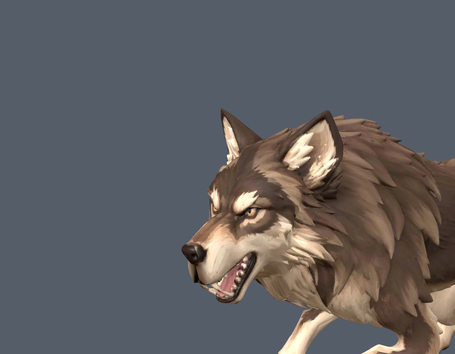
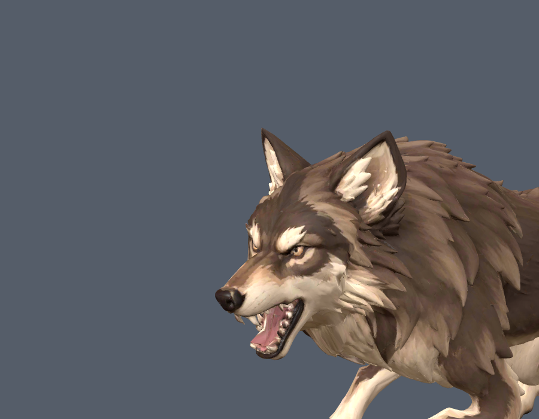

# Wolf V2 upper lip and jaw correction

The owner screenshot exposed a failure missed by the original nose-cap-only
test: the underside of the upper muzzle remained mostly on the jaw and dropped
about 0.073 model units during a bite. The expanded upper-lip regression fails
on the previous shipped asset and passes on this correction.




- [Previous motion](before.gif)
- [Corrected motion](after.gif)
- [Authoring and local dental repair](authoring.json)
- [Floor sweep](floor.json)
- [Final CharacterVisual runtime checks](runtime.json)

The source-space skin mask now covers the complete upper lip and underside of
the nose. The lower lip and mandible remain independently animated. Original
source files, skeleton, clip vocabulary, locomotion and island bindings remain
unchanged. No extra runtime deformation is added.

The source also has upper/lower canines joined by continuous tooth geometry.
Weights alone stretched those bridges into bars. The offline
`repair_wolf_v2_teeth.mjs` helper splits only the two local stalk patches,
leaves a 0.003 source-unit gap and closes all four ends with tapered caps.
It clips 61 original dental triangles and adds 166 net triangles. Upper dental
surfaces, including dark enamel, follow the skull; lower dental surfaces follow
the jaw. Cap winding, closed boundary loops, selected dental regions and lower
row preservation received a separate read-only review.

The new tests inspect the complete upper-lip region across 41 attack phases,
plus actual upper tooth roots/tips and moving lower dental landmarks during
all three attacks and howl. They no longer accept a rigid nose cap alone as
proof of a working mouth. The source repair is idempotent.

Validation on 2026-10-19:

```powershell
node node_modules/vitest/vitest.mjs run tests/smart_wolf_v2_asset.test.ts tests/smart_wolf_asset.test.ts tests/wolf_muzzle_skin.test.ts tests/animal_motion_flow.test.ts tests/animal_contact_pose.test.ts tests/quadruped_death_pose.test.ts tests/dev_model_lab.test.ts tests/model_gait_core.test.ts --maxWorkers=2
npm exec -- tsc --noEmit
node scripts/malware_scan.mjs --gate
```

All 78 tests in eight files pass. Type checking, scoped Biome, the Vite client
build and the security gate pass. The build uses an owned temporary output
directory with `copyPublicDir: false`. The mandatory asset and KTX2 passes were
rerun, followed by media-manifest generation. The final compressed asset is
used in both the close-up capture and the actual CharacterVisual transition
check, with no browser errors.

`GATE_SELECT_BASE=HEAD node scripts/gate_select.mjs` was rerun with the worktree's
safe-directory setting. It still stops at the existing staged/committed i18n
freshness comparison in this working tree. No staging was performed to bypass
it. The overall gate remains red; the scoped checks above pass.
