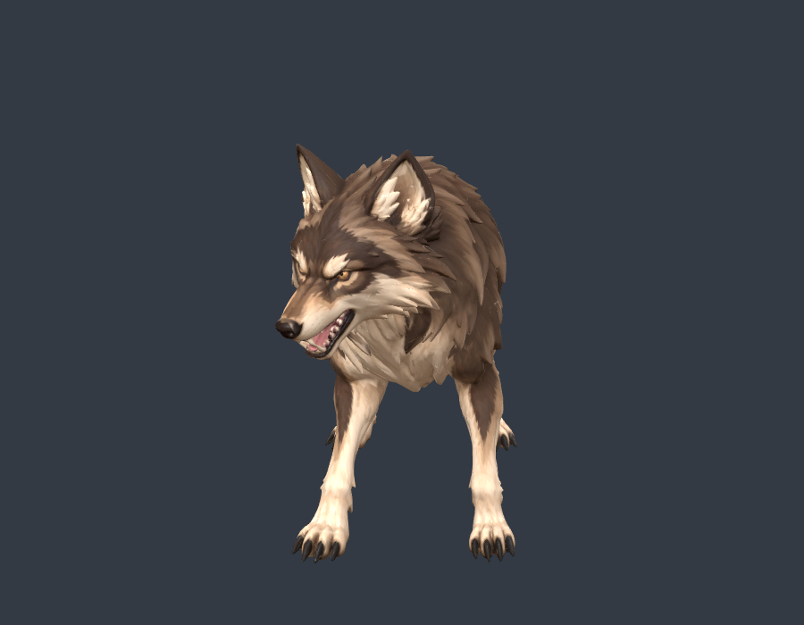
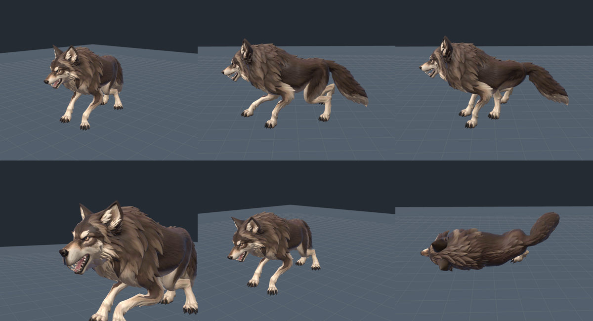

# Wolf V2 verification

This records the initial transfer pass. The owner subsequently demonstrated
upper-lip stretching missed by its nose-cap-only check. The current asset,
expanded regression coverage and before/after evidence are documented in the
[mouth correction](../wolf-mouth/verification.md).

The owner source remains untouched. The new normalized 47-joint model is a
separate `Smart Rig Wolf V2` subject at `(788, 72)` on `/devlab`; the original
wolf remains at `(812, 24)` for comparison.




- [Bite and mouth motion](bite.gif)
- [Walk](walk.gif), [run](run.gif), [relaxed collapse](death.gif)
- [Native authoring diagnostics](authoring.json)
- [Every-vertex floor sweep](floor.json)
- [Real CharacterVisual transition checks](runtime.json)
- [Source and retained asset hashes](preservation.txt)

The twelve accepted wolf timelines are adapted anatomically, rather than copied
by incompatible bone numbers. Normalization preserves native joint lengths and
rebakes the skin into its new bind pose. Original triangles, UVs and PBR maps
survive. Upper muzzle weights are corrected in original source coordinates;
the nose cap follows the skull and the actual lower lip follows the jaw.

The exported authoring diagnostics report no reach clamping and a minimum
two-link fold reserve of 0.0958 source units. The longer tail clears the floor
during movement. A 41-phase sweep of every skinned vertex in all twelve clips
has a minimum of -0.00508 source units, inside the 0.012 test tolerance.
All four final paw anchors are between 0.113 and 0.161 source units above the
floor, with the end pose held still. No animated bone scaling is used.

The shipping GLB is 6,833,360 bytes, Meshopt geometry plus three KTX2 textures.
The final texture pass converted only the new asset and skipped 104 existing
creature files. Speed references use the actual frame-rounded clip durations
and evaluated idle height, rather than nominal authored seconds.

Validation on 2026-10-19:

```powershell
node node_modules/vitest/vitest.mjs run tests/smart_wolf_v2_asset.test.ts tests/dev_model_lab.test.ts tests/smart_wolf_asset.test.ts tests/wolf_muzzle_skin.test.ts tests/animal_motion_flow.test.ts tests/animal_contact_pose.test.ts tests/quadruped_death_pose.test.ts tests/model_gait_core.test.ts --maxWorkers=2
npm exec -- tsc --noEmit
node scripts/malware_scan.mjs --gate
```

The scoped suite passes 74 tests in eight files. Type checking and the Vite
client build pass. The build uses `copyPublicDir: false` and an owned temporary
output directory to avoid duplicating the large public asset tree. Scoped Biome
checks pass; the manifest retains its pre-existing non-null assertion warning.
The security scan passes with no HIGH findings after priors.

The local Chrome check loads the final compressed asset through the actual
`CharacterVisual`, exercises walk/run, the left-right-left-right-lunge sequence,
idle recovery and held death, and reports no browser errors.

The required `GATE_SELECT_BASE=HEAD node scripts/gate_select.mjs` was run with
the worktree's safe-directory setting. It stops at `i18n freshness`: regenerated
i18n artifacts differ from the staged/committed copies in this existing working
tree. Nothing was staged or committed to bypass that check. The overall gate
therefore remains red despite the passing scoped validation.
